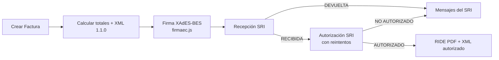

# 🧾 Sistema de Facturación Electrónica

[](https://github.com/XaviMontero/f-sri/actions/workflows/ci.yml)
[](https://github.com/XaviMontero/f-sri/actions)
[](https://github.com/XaviMontero/f-sri)
[](https://choosealicense.com/licenses/mit/)
[](https://nodejs.org/)
[](https://www.typescriptlang.org/)
[](https://www.mongodb.com/)
[](https://expressjs.com/)
[](https://github.com/XaviMontero/f-sri/releases)
[](CONTRIBUTING.md)
[](https://www.sri.gob.ec/)
[](https://www.npmjs.com/package/firmaec.js)


**Sistema de Facturación Electrónica** es un sistema libre y de código abierto diseñado específicamente para Ecuador, con integración completa al SRI (Servicio de Rentas Internas).

## 🚀 Características Principales

- ✅ **Facturación Electrónica Completa** - Generación, firma y envío al SRI
- 🔐 **Sistema de Registro Seguro** - Control multi-capa de acceso
- 📱 **API RESTful Completa** - Documentación con Swagger/OpenAPI
- 🏢 **Multi-empresa** - Gestión de múltiples empresas emisoras
- 📄 **PDFs Automáticos** - Generación y almacenamiento en la nube (Cloudinary/Local)
- 🔒 **Firma Digital** - Certificado digital en base64 (sin archivos locales)
- 📧 **Notificaciones Email** - Envío automático de facturas
- 🧪 **Testing Completo** - Suite de tests automatizados

## ✨ Flujo de Facturación Automático



### 🔄 Proceso Detallado

1. **📝 Creación**: `POST /api/v1/invoice/complete` (con `?esperar=true` responde cuando el SRI autoriza).
2. **🧮 Totales**: el servidor calcula subtotales, IVA por tarifa (15% vigente, 0%, 5%, exento…) y total a partir de
   las líneas. Si el cliente envía `totalSinImpuestos`/`importeTotal` y no coinciden, la factura se rechaza con 400.
3. **📄 XML**: esquema `factura` 1.1.0 (pagos, hasta 6 decimales en cantidad/precio).
4. **🔐 Firma**: XAdES-BES enveloped sobre `#comprobante` con [firmaec.js](https://github.com/XaviMontero/firmaec.js)
   (port a Node de la librería oficial FirmaEC). El `.p12` se usa en memoria, nunca se escribe a disco.
5. **📤 Recepción** y **✅ Autorización**: el ambiente (pruebas/producción) sale de `tipo_ambiente` de la empresa.
   El envío es idempotente y reanudable (`POST /api/v1/invoice/{id}/enviar`).
6. **📥 RIDE**: al quedar `AUTORIZADO` se genera el PDF (con código de barras de la clave) y se guarda en el proveedor configurado.

### 🏛️ Arquitectura

```
src/
├── domain/            # Reglas del SRI sin dependencias: AccessKey, Invoice, InvoiceLine, totales, catálogos
├── application/
│   ├── ports/         # Interfaces: DocumentSigner, SriGateway, repositorios, RidePublisher
│   └── use-cases/     # IssueInvoice (emitir) · SubmitInvoiceToSri (firmar → recepción → autorización)
├── infrastructure/    # Adaptadores: firmaec.js, SOAP del SRI, XML, Mongo, RIDE
├── modules/           # Nota de crédito, nota de débito, guía de remisión, retención (un módulo cada uno)
├── http/              # Mapeo del payload, errores de dominio → HTTP, tenant, router genérico de comprobantes
├── routes/            # Express
└── container.ts       # Composition root (único lugar que conoce las implementaciones)
```

## ✍️ Firma electrónica: firmaec.js

La firma XAdES-BES la hace [**firmaec.js**](https://www.npmjs.com/package/firmaec.js), port a Node.js de la librería
oficial FirmaEC. También firma **PDF (PAdES)** con firma visible y sello de tiempo, todo sin Java. Se puede usar sola
en cualquier proyecto Node:

```bash
npm install firmaec.js
```

```ts
import { firmarXml } from 'firmaec.js';

const xmlFirmado = await firmarXml(xmlComprobante, fs.readFileSync('firma.p12'), process.env.P12_PASSWORD!);
```

## 🧾 Todos los comprobantes electrónicos del SRI

| Comprobante | codDoc | Endpoint | Body |
|---|---|---|---|
| Factura | 01 | `POST /api/v1/invoice/complete` | `{ "factura": {...} }` |
| Nota de crédito | 04 | `POST /api/v1/credit-note/complete` | `{ "nota_credito": {...} }` |
| Nota de débito | 05 | `POST /api/v1/debit-note/complete` | `{ "nota_debito": {...} }` |
| Guía de remisión | 06 | `POST /api/v1/delivery-note/complete` | `{ "guia_remision": {...} }` |
| Retención (ATS 2.0.0) | 07 | `POST /api/v1/withholding/complete` | `{ "retencion": {...} }` |

Todos comparten el mismo flujo y endpoints: `?esperar=true`, `/{id}/enviar`, `/{id}/estado`, `/{id}/xml`,
`GET|POST /{id}/pdf` (RIDE), listado y borrado de borradores, siempre acotados a la empresa del token.
Los cinco fueron **AUTORIZADOS en el ambiente de pruebas del SRI** con un certificado real. Ejemplos de cada body en Swagger (`/docs`).

Las notas de crédito/débito, guía de remisión y retención son obra de **@gustavdz** (#21, #23, #25, #27),
integradas sobre la arquitectura por capas: cada comprobante es un módulo en `src/modules/<comprobante>/`
(dominio, caso de uso, XML, persistencia, RIDE y rutas) que reutiliza el pipeline común de firma y autorización.

Si la empresa ya emitió comprobantes en otro sistema, declara el último secuencial por tipo en
`ultimos_secuenciales` (p. ej. `{ "04": 120 }`) para evitar el error 45 "SECUENCIAL REGISTRADO".

## 🆕 Novedades: firma XAdES-BES y autorización SRI (octubre 2026)

Validado end to end en el **ambiente de pruebas del SRI** con un certificado real (Security Data):
facturas firmadas, recibidas y **AUTORIZADAS**, con su RIDE generado.

### Firma y SRI
- **Firma XAdES-BES** con [firmaec.js](https://github.com/XaviMontero/firmaec.js) (port a Node de la librería oficial
  FirmaEC). La firma anterior era XMLDSig genérico, que el SRI no acepta.
- El `.p12` se usa **en memoria**: ya no se escribe la clave privada en `/tmp` ni se prueban contraseñas "comunes".
- **Autorización**: antes solo se enviaba a recepción y `RECIBIDA` se trataba como final. Ahora se consulta
  `AutorizacionComprobantesOffline` con reintentos y se guardan número, fecha y XML autorizado.
- Envío **idempotente y reanudable**: `POST /api/v1/invoice/{id}/enviar` retoma desde el último paso
  (claves ya registradas en el SRI — mensajes 43/70 — se tratan como recibidas).
- El endpoint del SRI sale del `tipo_ambiente` de la empresa (antes una variable global podía no coincidir con el XML).

### Cálculo y XML
- Esquema `factura` **1.1.0** con `pagos`, hasta 6 decimales en cantidad y precio.
- **IVA 15%** vigente y catálogo completo de tarifas (0, 5, 12, 13, 14, 15, exento, no objeto). Antes estaba fijo en 12%
  y el IVA del encabezado ignoraba la cantidad.
- **Totales calculados en el servidor** a partir de las líneas (descuentos, agrupación por tarifa, propina). Si el cliente
  envía totales que no coinciden → 400, sin consumir secuencial.
- Validaciones del SRI: consumidor final (9999999999999, máximo USD 50), cédula/RUC, suma de pagos, máximo 15 campos adicionales.
- **Secuenciales atómicos** por establecimiento/punto de emisión (antes dos facturas simultáneas podían repetir número).
  Si vienes de otro sistema, registra la empresa con `ultimo_secuencial` (el último número ya emitido) para evitar el
  error 45 "SECUENCIAL REGISTRADO" del SRI; se puede subir luego con `PUT /api/v1/issuing-company/{id}`.
- **.p12 con varias claves**: se firma con el certificado que tiene uso `digitalSignature`, no con la primera clave del archivo.
- Consumidor final y compradores ad-hoc sin necesidad de registrarlos como cliente; líneas sin producto si traen descripción y precio.

### Nuevos endpoints
- `POST /api/v1/invoice/complete?esperar=true` — responde cuando el SRI autoriza o rechaza.
- `POST /api/v1/invoice/{id}/enviar`, `GET /api/v1/invoice/{id}/estado`, `GET /api/v1/invoice/{id}/xml`.
- `POST /api/v1/invoice-pdf/regenerate/{id}` ahora regenera el RIDE de verdad (antes era un stub).
- Con almacenamiento local, el servidor sirve los PDFs en `/pdfs`.
- Búsquedas por clave lógica (idea de #19): `GET /api/v1/product/code/{codigo}`, `GET /api/v1/client/docid/{identificacion}`,
  `GET /api/v1/identification-type/code/{codigo}`.

### RIDE
- Código de barras Code128 de la clave de acceso, subtotales por tarifa, formas de pago e información adicional reales.
- Todo el contenido se escapa (antes un nombre con HTML se inyectaba en el PDF).

### Seguridad
- Facturas, PDFs y empresa emisora **acotados a la empresa del token** (antes cualquier usuario veía y modificaba datos ajenos).
- El certificado y su contraseña **nunca** salen por la API (`tiene_certificado: true` en su lugar).
- Eliminado `certificatePath` en `PUT /issuing-company`, que permitía leer archivos arbitrarios del servidor.
- Una factura **AUTORIZADA no se puede eliminar** (409); `PUT /invoice/{id}` y `POST /invoice` crudo se retiraron.

### Arquitectura y calidad
- Capas DDD/hexagonal (ver Arquitectura) con composition root en `src/container.ts`.
- Tests de **Jest a Vitest** (firmaec.js es ESM): **612 tests** de dominio, casos de uso, adaptadores (firma verificada
  criptográficamente, SOAP del SRI) e integración HTTP con Mongo en memoria. Cobertura ≥ 80% exigida en CI.
- CI en Node 22/24 · `scripts/e2e-sri-pruebas.sh` para probar contra el SRI real.

### ⚠️ Cambios incompatibles
- `PUT /api/v1/invoice/{id}` y `POST /api/v1/invoice` (sin `/complete`) ya no existen.
- Rutas de PDFs: `/invoice-pdf/invoice/{id}`, `/invoice-pdf/access-key/{clave}`, `/invoice-pdf/download/{clave}`.
- `SRI_ENVIRONMENT` ya no se usa: el ambiente lo define cada empresa.
- Requiere Node ≥ 20.19 y `ENCRYPTION_KEY`/`JWT_SECRET` definidos al arrancar.

## 🛠️ Tecnologías

- **Backend**: Node.js + TypeScript + Express
- **Base de Datos**: MongoDB + Mongoose
- **Autenticación**: JWT + bcrypt
- **Documentación**: Swagger/OpenAPI 3.0
- **Testing**: Vitest + Supertest + mongodb-memory-server
- **Firma Digital**: firmaec.js (XAdES-BES)
- **PDF**: Puppeteer
- **Almacenamiento**: Cloudinary (por defecto) / Local

## 📦 Instalación Rápida

```bash
# Clonar el repositorio (requiere Node ≥ 20.19 y MongoDB; `docker compose up -d` levanta uno)
git clone https://github.com/XaviMontero/f-sri.git
cd f-sri

# Instalar dependencias (descarga también el Chrome que usa el RIDE)
npm install

# Configurar variables de entorno
cp .env.example .env
# Obligatorias: MONGO_URI, JWT_SECRET, MASTER_REGISTRATION_KEY y
# ENCRYPTION_KEY (genérala con: openssl rand -hex 32).
# Los PDFs se guardan en local por defecto; Cloudinary es opcional.

# Ejecutar en desarrollo
npm run dev

# Construir para producción
npm run build
npm start
```

## ⚙️ Configuración

### Variables de Entorno Esenciales

```env
# Base de datos
MONGODB_URI=mongodb://localhost:27017/f-sri

# Seguridad
JWT_SECRET=tu_clave_jwt_super_secreta_aqui
ENCRYPTION_KEY=clave_encriptacion_32_caracteres!!
MASTER_REGISTRATION_KEY=clave_maestra_super_secreta

# Servidor
PORT=3000
NODE_ENV=development

# SRI Ecuador: el ambiente sale de `tipo_ambiente` de cada empresa (1=Pruebas, 2=Producción).
# Los endpoints oficiales vienen por defecto; ver .env.example para sobreescribirlos.

# Almacenamiento de PDFs (cloudinary o local)
PDF_STORAGE_PROVIDER=cloudinary  # Por defecto: cloudinary

# Cloudinary (para almacenar PDFs en la nube)
CLOUDINARY_CLOUD_NAME=tu_cloud_name
CLOUDINARY_API_KEY=tu_api_key
CLOUDINARY_API_SECRET=tu_api_secret
```

### Primer Registro (Administrador)

El certificado digital (archivo .p12) debe ser convertido a **base64** y enviado como una cadena de texto:

```bash
# Convertir certificado .p12 a base64 (Linux/Mac)
base64 -i certificado.p12 -o certificado_base64.txt

# O en PowerShell (Windows)
[Convert]::ToBase64String([IO.File]::ReadAllBytes("certificado.p12"))
```

Luego, enviar el registro con el certificado en base64:

```bash
POST /register
{
  "email": "admin@miempresa.com",
  "password": "password123",
  "masterKey": "clave_maestra_super_secreta",
  "ruc": "1234567890001",
  "razon_social": "Mi Empresa S.A.",
  "certificate": "MIIJqQIBAzCCCW8GCSqGSIb3DQEHAa...",  // Certificado .p12 en base64
  "certificate_password": "password_del_certificado"
}
```

## 🔒 Sistema de Seguridad

El Sistema de Facturación Electrónica implementa un sistema de registro de múltiples capas:

1. **Primer Registro**: Requiere `MASTER_REGISTRATION_KEY`
2. **Registros Posteriores**: Códigos de invitación o RUCs en whitelist
3. **Control Total**: Posibilidad de deshabilitar registros

```env
# Códigos de invitación
INVITATION_CODES=INV2024001,INV2024002,DEMO2024

# RUCs pre-aprobados
ALLOWED_RUCS=1234567890001,0987654321001

# Deshabilitar registro
DISABLE_REGISTRATION=true
```

## 📚 Documentación API

Una vez ejecutando el servidor, accede a:

- **Swagger UI**: `http://localhost:3000/api-docs`
- **API JSON**: `http://localhost:3000/api-docs.json`

### Endpoints Principales

```bash
# Autenticación
POST /register          # Registro de usuario y empresa
POST /auth             # Autenticación
GET  /status           # Estado del sistema

# Facturación (todas acotadas a la empresa del token)
POST /api/v1/invoice/complete[?esperar=true]  # Emitir: firma, envía y (opcional) espera la autorización
POST /api/v1/invoice/{id}/enviar              # Reintentar firma/envío/autorización
GET  /api/v1/invoice/{id}/estado              # Estado SRI, número y fecha de autorización, mensajes
GET  /api/v1/invoice/{id}/xml                 # XML autorizado
GET  /api/v1/invoice                          # Listar facturas

# PDFs (Generación Automática)
GET  /api/v1/invoice-pdf                    # Listar todos los PDFs
GET  /api/v1/invoice-pdf/invoice/{id}            # PDF por ID de factura
GET  /api/v1/invoice-pdf/download/{claveAcceso}  # Descargar PDF
GET  /api/v1/invoice-pdf/access-key/{claveAcceso} # PDF por clave de acceso
POST /api/v1/invoice-pdf/regenerate/{id}    # Regenerar PDF

# Gestión
GET  /api/v1/issuing-company    # Empresas emisoras
GET  /api/v1/client            # Clientes
GET  /api/v1/product           # Productos
```

### 📄 Gestión de PDFs

Los PDFs se generan **automáticamente** cuando el SRI autoriza la factura (`estado: "AUTORIZADO"`) y se almacenan en el proveedor configurado (Cloudinary por defecto). No requiere intervención manual.

```bash
# Verificar si una factura tiene PDF generado
curl -H "Authorization: Bearer $TOKEN" \
  http://localhost:3000/api/v1/invoice-pdf/invoice/64f8a1b2c3d4e5f6a7b8c9d2

# Descargar PDF de factura
curl -H "Authorization: Bearer $TOKEN" \
  http://localhost:3000/api/v1/invoice-pdf/download/$CLAVE_ACCESO \
  -o factura.pdf
```

## 🧪 Testing

```bash
npm test                  # unitarios + integración (Mongo en memoria, firma real con un .p12 generado)
npm run test:unit
npm run test:integration
npm run test:coverage
```

### E2E contra el ambiente de pruebas del SRI

Con el servidor levantado y la base vacía, autoriza una factura real de punta a punta
(registro con tu `.p12` → producto → factura → firma → recepción → autorización → RIDE):

```bash
P12=/ruta/firma.p12 P12_PASSWORD='***' RUC=0999999999001 RAZON_SOCIAL='MI EMPRESA' \
MASTER_REGISTRATION_KEY=... API=http://localhost:3000 npm run e2e:sri
```

Si el RUC ya emitió comprobantes en la serie 001-001, agrega `ULTIMO_SECUENCIAL=<último número>`.

Cada comprobante adicional tiene su E2E opt-in con Vitest (se omite sin las variables):

```bash
SRI_E2E_P12=/ruta/firma.p12 SRI_E2E_PASSWORD='***' npx vitest run test/e2e
```

## 🚀 Despliegue

### Heroku

```bash
# Crear app
heroku create tu-sistema-facturacion

# Configurar variables
heroku config:set MONGODB_URI=tu_mongodb_uri
heroku config:set JWT_SECRET=tu_jwt_secret
heroku config:set MASTER_REGISTRATION_KEY=tu_clave_maestra

# Desplegar
git push heroku main
```

### Docker

```dockerfile
FROM node:18-alpine
WORKDIR /app
COPY package*.json ./
RUN npm ci --only=production
COPY dist ./dist
EXPOSE 3000
CMD ["npm", "start"]
```

## 🤝 Contribuir

¡Las contribuciones son bienvenidas! Por favor lee [CONTRIBUTING.md](CONTRIBUTING.md) para detalles.

### Proceso de Contribución

1. Fork el proyecto
2. Crea una rama para tu feature (`git checkout -b feature/AmazingFeature`)
3. Commit tus cambios (`git commit -m 'Add some AmazingFeature'`)
4. Push a la rama (`git push origin feature/AmazingFeature`)
5. Abre un Pull Request

## 📋 Roadmap

- [ ] **v1.1**: Notas de crédito y débito
- [ ] **v1.2**: Retenciones
- [ ] **v1.3**: Guías de remisión
- [ ] **v1.4**: Dashboard web
- [ ] **v1.5**: App móvil
- [ ] **v2.0**: Microservicios

## 📄 Licencia

Este proyecto está bajo la Licencia MIT. Ver [LICENSE](LICENSE) para más detalles.

La firma electrónica usa [firmaec.js](https://www.npmjs.com/package/firmaec.js) (dependencia de npm), distribuida bajo
**AGPL-3.0-or-later** por derivar de la librería FirmaEC; sus términos aplican a ese componente.

## 🆘 Soporte

- 📖 **Documentación**: [Wiki del proyecto](https://github.com/XaviMontero/f-sri/wiki)
- 🐛 **Issues**: [GitHub Issues](https://github.com/XaviMontero/f-sri/issues)
- 💬 **Discusiones**: [GitHub Discussions](https://github.com/XaviMontero/f-sri/discussions)
- 📧 **Email**: soporte@f-sri.org

## 🙏 Agradecimientos

- [SRI Ecuador](https://www.sri.gob.ec/) por la documentación técnica
- Comunidad de desarrolladores
- Todos los [contribuidores](https://github.com/XaviMontero/f-sri/contributors)

---

**⭐ Si este Sistema de Facturación Electrónica te resulta útil, ¡dale una estrella en GitHub!**

Hecho con ❤️ para la comunidad ecuatoriana de desarrolladores.
